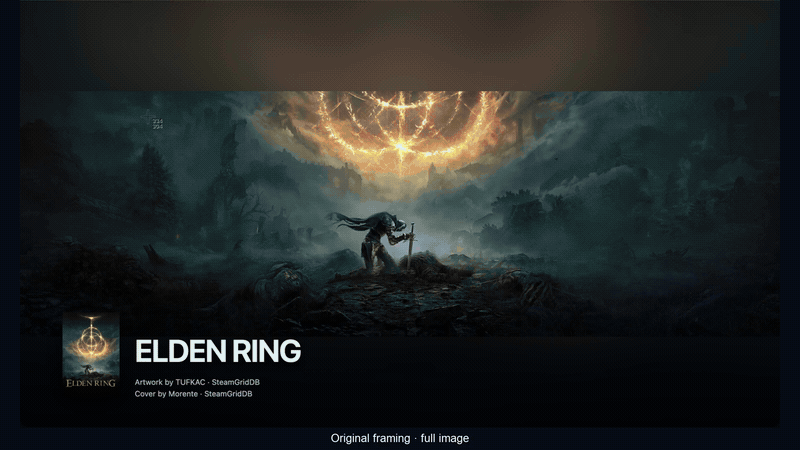
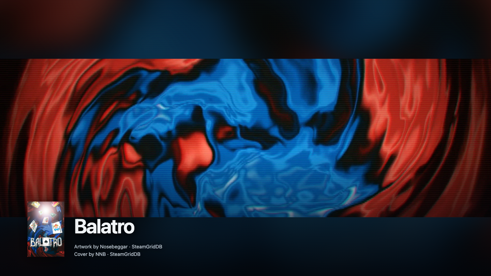
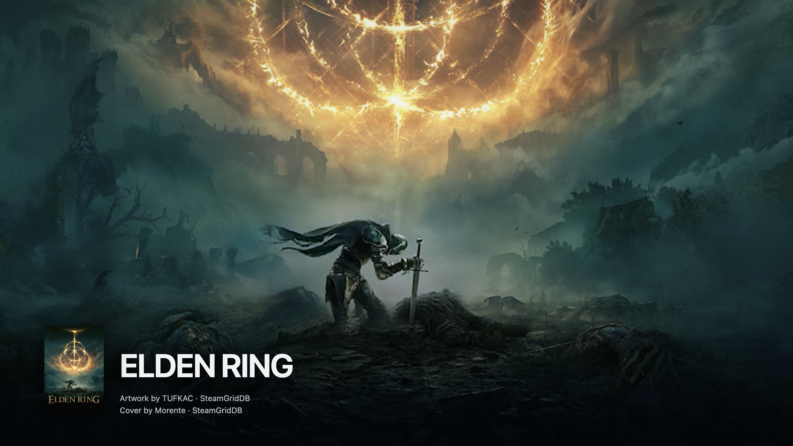
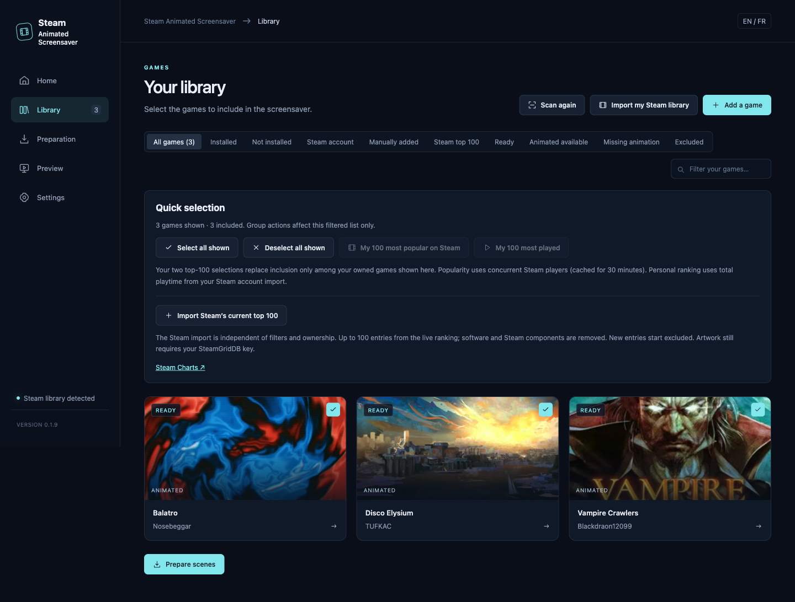
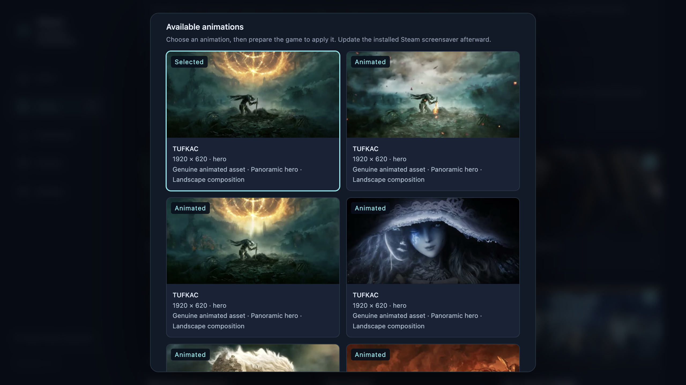
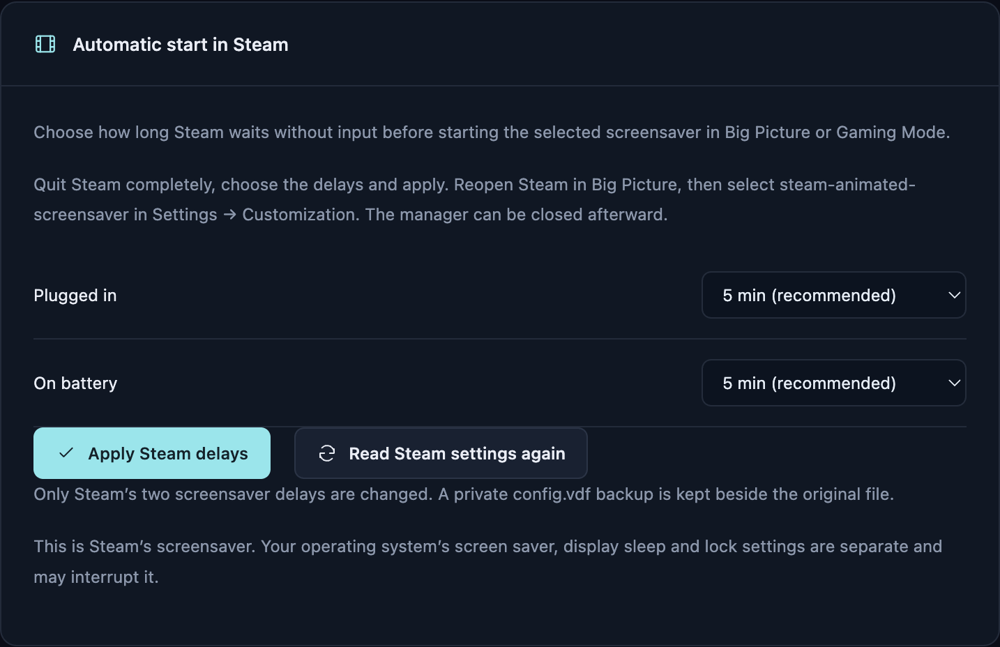

# Steam Animated Screensaver

Use animated artwork from [SteamGridDB](https://www.steamgriddb.com/) as a screensaver in SteamOS Gaming Mode or Steam Big Picture on macOS, Windows and Linux.

Choose games, prepare their animations and install the screensaver in Steam. Prepared playback works offline with this app closed. No Decky plugin or hosted server is needed.

[](docs/DEMO.md)

[Demo videos and credits](docs/DEMO.md) · [Download version 1.0.0](https://github.com/Alyenax/Steam-Animated-Screensaver/releases/tag/v1.0.0)

Maintained by [Alyenax](https://github.com/Alyenax).

<details>
<summary>Features and screenshots</summary>

## What you can do

- Scan installed games, import owned games that are not installed, or search by title / Steam AppID. Proton and other Steam components are filtered out.
- Select all filtered games, your top 100 by playtime or current player count, or discover Steam's current top 100.
- Choose an animation and a separate still cover for each game. Place the cover beside the title or in three screen corners.
- Keep the full image or crop it to 16:9 / 16:10, with an adjustable focal point.
- Set scene duration, shuffle and transitions. Optional 24/30 fps processing can help with some sources; it can be slow and does not fix every animation.
- Set Steam's inactivity delays. A first configuration proposes **5 minutes** on AC and battery; saved choices are preserved.
- Follow preparation progress, pause/resume, purge downloaded media and read local JSON error logs.

| Original framing: full image | Cropped to 16:9 |
| --- | --- |
|  |  |





</details>

## Downloads

[Releases](https://github.com/Alyenax/Steam-Animated-Screensaver/releases) · [Installation guide](docs/INSTALLATION.md) · [Changelog](CHANGELOG.md)

| Platform | Package | Launch |
| --- | --- | --- |
| SteamOS / Steam Deck / Steam Machine | x64 `.tar.gz` | In Desktop Mode, extract and run `./install.sh` |
| Linux desktop | x64 `.tar.gz` | Extract and run `./install.sh` |
| Windows | x64 portable `.zip` | Extract the whole folder and run `Steam Animated Screensaver.exe` |
| macOS 13+ | Apple Silicon `.dmg` or `.zip` | Drag the app to Applications |

The app starts in English; French can be selected in Settings. Saved language choices are retained.

Intel Mac and Windows ARM64 builds are not supplied. The Mac app is not notarized; the Windows app is unsigned. See the installation guide for platform requirements.

## Apply the screensaver in Steam

1. **In this app:** save a personal [SteamGridDB API key](https://www.steamgriddb.com/profile/preferences/api), then scan or add games. Importing uninstalled owned games also needs a separate Steam Web API key and a SteamID/profile with visible game details; a SteamID alone is not enough.
2. Include the games you want, click **Prepare** and check **Preview**.
3. Click **Install in Steam**. In Steam, open **Big Picture → Settings → Customization → Screensavers**, select **steam-animated-screensaver**, then try **Preview**. SteamOS Gaming Mode has the same Customization section. Restart Steam if the new entry is missing.
4. **Set automatic start:** quit Steam completely using its **Exit / Quit Steam** menu, not just the window's close button. In this app, open **Settings → Automatic start in Steam**, choose the delays and click **Apply Steam delays**. **5 minutes** is the suggested starting point; **Disabled** turns either timer off.
5. Reopen Steam in Big Picture or Gaming Mode and leave it idle. You can close this app. After changing animations or playback settings later, click **Update / Repair** to update Steam's installed copy.

<details>
<summary>Automatic start settings and Steam limitations</summary>



**Why is there a delay setting here?** In the stable Steam client inspected on October 16, a device with a battery outside Gamescope gets a link from Customization to Power, but Power hides the delay controls. The same condition exists in the current macOS, Windows and Linux UI. Desktops without a battery already have a direct control; Gamescope has the controls in Power. Our app saves Steam's two delay settings with a private backup and refuses to write while Steam is running. It does not patch Steam or run a background idle watcher. [Investigation and limits](docs/STEAM_IDLE_INVESTIGATION.md).

Your operating system's screensaver, display sleep and lock are separate and can interrupt Steam. Changing the macOS screensaver delay does not configure Steam. The custom screensaver feature requires a recent Steam client; see Valve's [October 13 stable notes](https://www.steamdeck.com/en/news?pubDate=20261013).

</details>

## Testing and contributions

Testers are welcome on every platform, especially **Linux and Windows**. SteamOS and macOS have received the most hands-on attention. Windows/Linux packages have automated and archive checks; native Steam playback and longer sessions still need testing on real machines.

<details>
<summary>Reporting issues and contributing</summary>

Useful reports include your OS, Steam version, app version, what you did and what happened. For playback issues, include the game, artwork source and processing settings. Review local logs before attaching them; native crash dumps may contain private process data. [Open an issue](https://github.com/Alyenax/Steam-Animated-Screensaver/issues) · [Validation](docs/VALIDATION.md).

Contributors are welcome. Many SteamGridDB animations have a low frame rate, which is more noticeable fullscreen. Help with smoothing, processing speed, reliability or platform support would be appreciated. See [CONTRIBUTING.md](CONTRIBUTING.md).

</details>

<details>
<summary>Development and credits</summary>

```sh
npm ci
npm run check
npm test
npm start
```

Node 22.12+ is required for development. [Architecture](docs/ARCHITECTURE.md) · [Storage and privacy](docs/STORAGE.md) · [Third-party components](docs/THIRD_PARTY.md).

Original app code is [MIT licensed](LICENSE). This is an unofficial project, unaffiliated with Valve or SteamGridDB. Artwork belongs to its owners and artists; users download it separately, and it is not bundled with the app. [Visual credits](screenshots/public/CREDITS.md).

</details>
