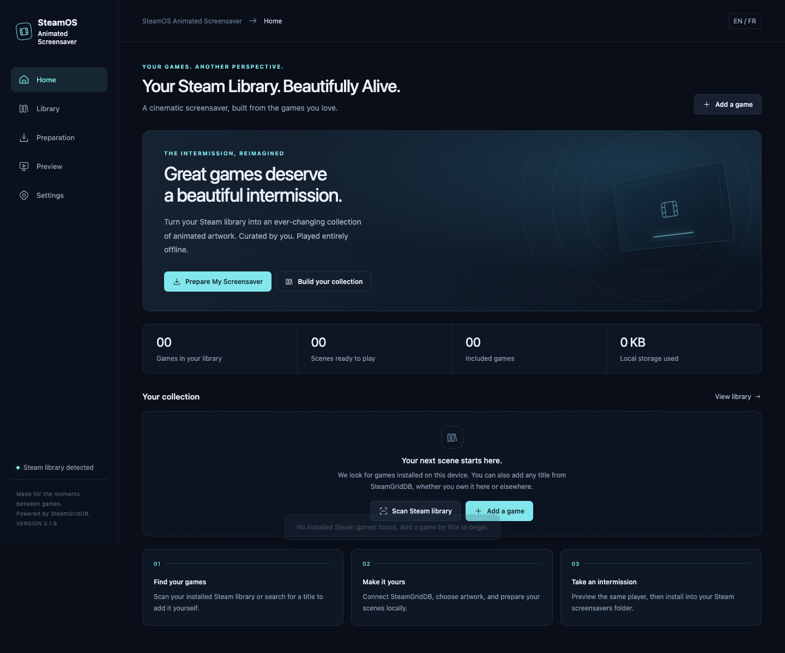
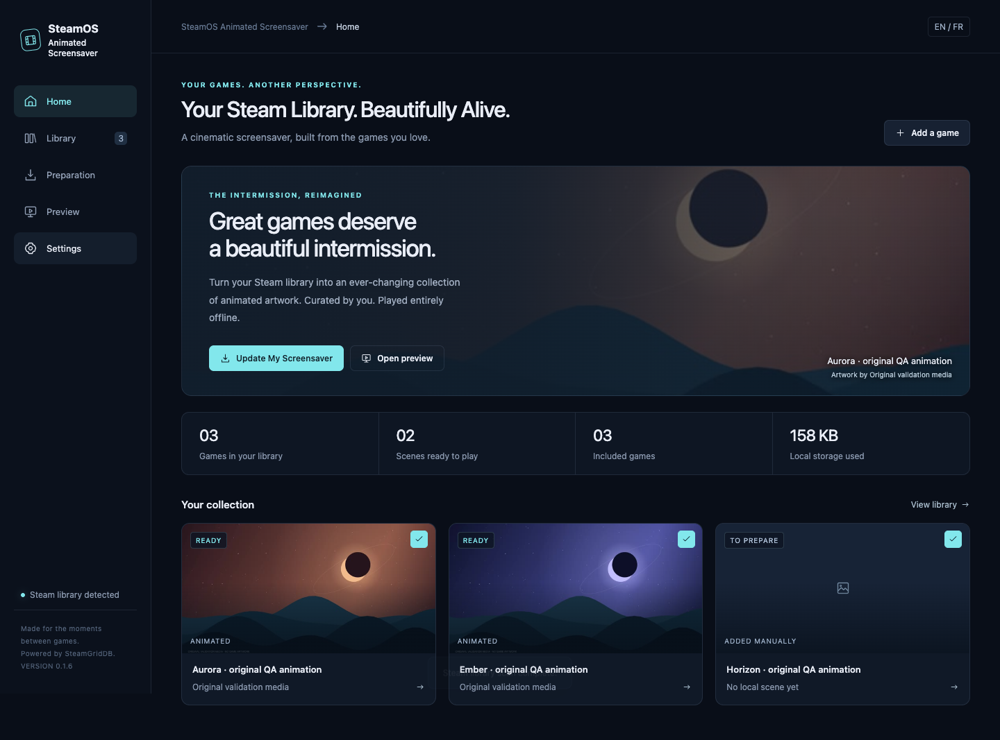
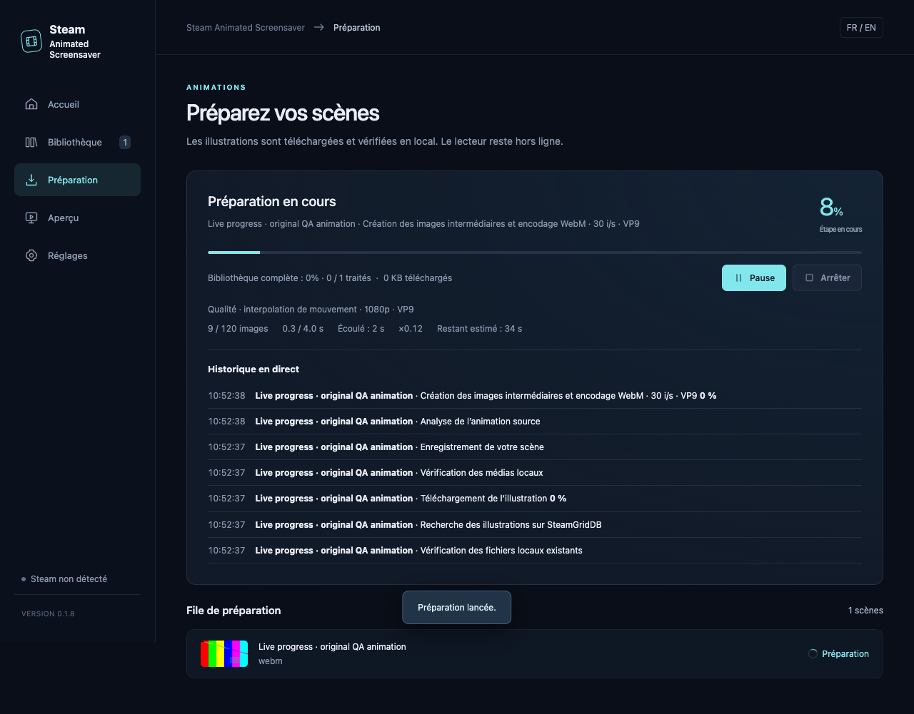

# SteamOS Animated Screensaver

**Bring Your Steam Library to Life.**

Turn your Steam games into an animated screensaver powered by SteamGridDB. Scan installed games, optionally import owned games from Steam, add any title manually, choose an artist's animation, prepare it once, and enjoy it entirely offline.

**0.1.6 is a private installation candidate.** The manager, media pipeline and player are exercised locally. Physical SteamOS/Gaming Mode and Steam Machine acceptance remain pending. See [validation evidence](docs/VALIDATION.md) before installing on your main device.



The application uses its full name, **SteamOS Animated Screensaver**, throughout the interface. No GabeCubeAura, Decky Loader, account password, or permanent background service is required.

## Your library, your intermission

- Automatically scan Steam manifests, including secondary libraries, entirely offline. Hide Proton, Steam Linux Runtime and Steamworks redistributables from the catalog, including previously saved entries.
- Add games by name, Steam AppID or Steam Store URL using one personal SteamGridDB key. Select the exact result when names overlap.
- Prefer actual animated Heroes, then animated Grids. Still artwork is clearly labelled and disabled by default.
- Prepare incrementally with a persistent queue, pause, resume, cancellation and retry. Keep manual artwork choices and creator credits.
- Browse a responsive English/French gallery, preview the same offline player, then install a local snapshot into Steam.
- Add a fixed game cover beside the title or in three screen corners, using matching margins and local creator credits.
- Optionally prepare a smoother 24 or 30 fps video offline, keeping original animations for an immediate return to their original rendering.
- Preserve media proportions with a subdued blurred surround, crossfade or fade to black, shuffle and game-title controls.



**Screenshot provenance:** the prepared gallery above runs the actual application with original test animations and a mocked SteamGridDB provider. Its titles explicitly identify QA animations. These screenshots are illustrative QA media, separate from the successful live personal-key API tests on Portal 2 and Cyberpunk 2077 recorded in docs/LIVE_VALIDATION.json. Downloaded game artwork was deleted after those tests. All six requested views and responsive captures are in [screenshots](screenshots/); the procedure is reproducible with `node scripts/ui-qa.cjs --capture`.

## Steam Machine error -105 on 0.1.0

The initial space-containing export identifier has been replaced with `steamos-animated-screensaver`. [Repair instructions](docs/STEAM_ERROR_105.md) include a small script that preserves existing media. Restart Steam and select the new identifier afterward. The affected device still needs to confirm the correction.

## Install the Linux x64 candidate

Download the `.tar.gz` and `SHA256SUMS` from the private release. Steam Deck/Steam Machine are the intended hardware; the binary has not yet been executed on those devices. In Desktop Mode:

```sh
sha256sum -c SHA256SUMS
tar -xzf SteamOS-Animated-Screensaver-0.1.6-linux-x64.tar.gz
cd steamos-animated-screensaver-linux-x64
./install.sh
```

Open **SteamOS Animated Screensaver** from the application launcher. Add your personal API key in Settings, rescan or add games, then choose **Prepare My Screensaver**. Preview the result and use **Install screensaver**. In Steam, select **steamos-animated-screensaver** in **Settings → Customization → Screensavers**. Restart Steam if its selector has not refreshed.

The application installs to `~/.local/opt/steamos-animated-screensaver`; it does not disable SteamOS read-only mode, use `sudo`, install global dependencies, or change Steam manifests. The package contains Electron and separate FFmpeg/FFprobe tools. It expects a Linux x64 graphical desktop with the system libraries Electron needs; see [installation](docs/INSTALLATION.md).

## Original framing or a true 16:9 / 16:10 crop

Choose **Settings → Playback → Framing** (also available in Preview): **Original** keeps the existing complete-image display; **16:9** or **16:10** fills an exact-ratio frame without stretching. On a differently shaped screen, the ambient surround remains outside that frame.

In **Library → Game details → Framing**, override the general setting for one game and move the visible area horizontally or vertically, or center it. An axis is disabled when that source needs no cropping on it. Changes save automatically and affect Preview immediately. Originals and processed videos remain intact: no download, interpolation or preparation is needed. Choose **Update / repair** to apply saved framing to Steam's installed snapshot.

Steam compatibility components are removed automatically from scans, account imports, manual discovery and previously saved catalogs. Their actual Steam installations are untouched. Already cached files remain available for explicit unused-media cleanup. Names are matched conservatively so games such as Proton Pulse and Protonwar remain visible.

## Covers and optional smoothing

In **Settings → Playback**, enable **Show a still cover** and choose **Cover position**: beside the title, bottom right, top right or top left. The same controls are also in Preview. Each corner uses the title's horizontal/vertical margins. Prepare the library once to cache static portrait Grids from SteamGridDB; an existing local thumbnail is used when none is available. Cover and animation credits remain separate. In **Library → Game details → Fixed artwork → Choose / change fixed artwork**, select another still image; it is prepared immediately without replacing the animation. **Use automatic artwork** restores automatic selection.

**Smooth animations** is off by default. Choose **24 or 30 fps** and a processing method:

| Method | Processing | Output |
| --- | --- | --- |
| Fast (default for new settings) | Motion interpolation with a smaller search and lower processing resolution | Up to 720p, VP8 |
| Quality | Detailed motion interpolation, the previous processing method | Up to 1080p, VP9 |
| Very light | Blend neighboring frames without motion estimation; may show double edges | Up to 720p, VP8 |

Existing enabled smoothing settings migrate to Quality / 30 fps. No profile upscales the source. Already fluid animations keep their original frame rate. Enable smoothing, choose a profile, prepare again, preview, then **Update / repair** to apply to Steam. Changes to the profile or target fps regenerate only the derivative from the locally retained original. **Maximum size per processed video (MB)** defaults to **0** (no per-video limit); your total library limit and free disk space still apply. Disable smoothing and update to restore original playback. Optional failures keep the original playable.

Preparation shows the **current step's actual percentage**, separate from completed games, plus processed frames, elapsed time, processing speed and an estimated remaining time when available. WebP reconstruction, interpolation/encoding, final decoding validation and saving are shown separately. Indeterminate work is marked as such instead of displaying a fabricated percentage. The dated activity log keeps the last 250 events in the catalog (100 displayed), including failures and pauses. Pause/cancel interrupt unfinished processing; resume starts that unfinished step again and reuses completed files.

A synthetic 3-second 720p animation took 9.16 s in Quality / 30 fps, 7.79 s in Fast / 30 fps, and 0.96 s in Very light / 30 fps on the development Mac. Quality / 24 fps took 6.13 s. These are sample measurements, not Steam Machine performance claims. See [reproducible benchmark data](docs/SMOOTHING_BENCHMARK.json) and [actual live-progress UI checks](docs/PROGRESS_VALIDATION.json).



## Import games that are not installed

In **Settings → Steam library import**, save your **SteamID64 or Steam Community profile URL** and your personal **Steam Web API key** from [Steam](https://steamcommunity.com/dev/apikey). This key is distinct from SteamGridDB. Choose **Import my Steam library**; the app calls Steam directly, without a hosted service or Steam login integration.

Imported titles appear in **My Library**, with **Steam account** and **Not installed** filters. Existing games and manual choices are preserved and duplicates merge by AppID. New imported titles start excluded: include the ones you want, then prepare their SteamGridDB artwork. The imported catalog remains available offline. A failed import leaves it intact. Game details must be accessible to the official API; free games are included when previously played. This does not discover borrowed Family Sharing games as owned titles. Account import has provider-fixture coverage; a live personal Steam-key check is still pending. Remove the Steam API key separately in Settings.

Search, library, preparation and alternative galleries normalize provider thumbnails into locally cached JPEGs, including thumbnails supplied as WebM videos. Missing/corrupt thumbnails fall back to available source media; unavailable assets show an explicit placeholder. Search results beyond the first eight load artwork on demand.

The promotional sentence above each scene title has been removed. The small `remove-screensaver-tagline.sh` also hides it in existing owned installations without preparing media again.

## Purge downloaded and processed media

In **Settings → Local storage → Purge all media**, confirm the permanent deletion. The app stops preparation and preview downloads, removes downloaded originals, processed/smoothed animations, still artwork, previews and unfinished interpolation files, and uninstalls this app's Steam screensaver snapshot. Your games, inclusion choices, selected animation/fixed artwork, settings and both API keys remain.

The preparation queue resets and the storage panel records the purge date and removed local-cache bytes. The cache stays empty across navigation/restart; automatic previews resume only after an explicit artwork search/gallery request or preparation. To use the screensaver again, **Prepare**, then **Install screensaver**. Cancelling the confirmation changes nothing. **Remove unused media** remains a separate, smaller cleanup that preserves referenced media.

Deletion is limited to the application's cache folders and owned Steam exports. Unknown directories/links or a foreign Steam destination block the purge instead of being traversed. A file-removal error is reported; the catalog stays unprepared and the same purge can be retried after resolving it. No personal media was erased during validation: all deletion tests use isolated fixtures.

## Update and remove

Close the manager, download and verify the next candidate, and run its `install.sh`. Your catalog, key and prepared media are preserved. After catalog or playback changes, use **Update / repair** to republish the installed Steam snapshot.

To remove the screensaver, use **Settings → Uninstall**. To remove the manager, run `~/.local/opt/steamos-animated-screensaver/uninstall.sh`. Local media and settings remain until you explicitly erase them. See the [full uninstall and recovery guide](docs/INSTALLATION.md).

## Build and develop

Use Node 22.12 or newer and npm. The dependency lockfile is committed.

```sh
npm ci
npx install-electron
npm test
npm run check
npm start
```

`npm run dev` prints a local browser URL for UI development. `npm run package:linux` cross-packages the Linux x64 tar archive. It downloads Electron with its upstream checksums and the pinned FFmpeg distribution; the build records binary provenance and SHA-256 hashes. No GitHub Actions workflow is present, and Actions is disabled in the dedicated repository.

The application is three independent modules: [Core](docs/CONTRACTS.md), [Manager](manager/) and [Player](docs/PLAYER.md). See [architecture](docs/ARCHITECTURE.md), [storage and ranking](docs/STORAGE.md), [contribution guidance](CONTRIBUTING.md), and [third-party notices](docs/THIRD_PARTY.md).

## Current limits

No Windows compatibility is advertised. Installed tools and demos are classified conservatively by local name heuristics. A manually added SGDB-only identity is merged with a later installation once an authoritative Steam↔SGDB mapping is available; offline scanning cannot invent that mapping.

Ranking is deterministic from the metadata the API actually supplies. Decoder validity and real animation are checked during preparation. Artistic loop continuity, black endings, logo placement and aesthetic quality are not automatically scored in this candidate. Choose an alternative manually when needed. No measurements of SteamOS battery use, 4K performance, Steam CEF codecs or physical dismissal are claimed.

Original source is MIT licensed. Third-party executable licenses remain separate. Downloaded artworks belong to their respective creators and rights holders and are never bundled with releases. Public binary distribution remains gated on the recorded redistribution review and target-device acceptance.

**Not affiliated with or endorsed by Valve or SteamGridDB.**
